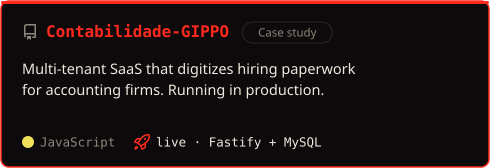
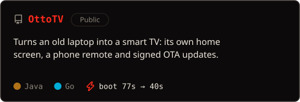
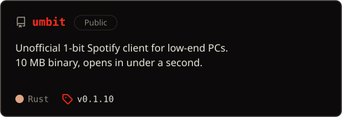
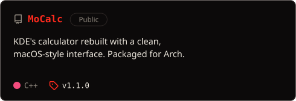
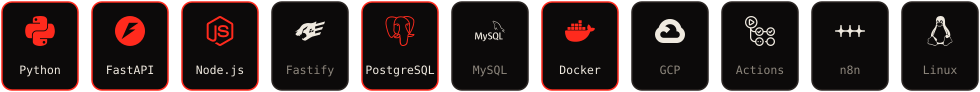

<a href="https://gabrielmoreno.dev">
  
</a>

<p>
  <a href="https://gabrielmoreno.dev"></a>
  <a href="https://www.linkedin.com/in/jgabriel-moreno-dev/"></a>
  <a href="mailto:jgabriel.moreno@icloud.com"></a>
</p>

Backend developer from Taubaté, Brazil. I build **APIs, integrations and automations** that take repetitive work off people's hands, and I take projects from the first requirements call to cloud deploy and the support that comes after launch.

I don't know everything yet. What I know is how to find out, and I don't ship work I wouldn't sign.

<details>
<summary><b>PT-BR</b></summary>
<br>

Desenvolvedor back-end de Taubaté. Construo APIs, integrações e automações que tiram trabalho repetitivo das mãos das pessoas, e levo projetos da primeira conversa de requisitos até o deploy em nuvem e o suporte depois do lançamento.

Ainda não sei tudo. O que eu sei é descobrir, e não entrego trabalho que eu não assinaria. Mais em [gabrielmoreno.dev](https://gabrielmoreno.dev/pt/).

</details>

### `$ ls ~/projects`

<p>
  <a href="https://github.com/gmoreno-dev/Contabilidade-GIPPO"></a>
  <a href="https://github.com/gmoreno-dev/OttoTV"></a>
  <a href="https://github.com/gmoreno-dev/umbit"></a>
  <a href="https://github.com/gmoreno-dev/MoCalc"></a>
</p>

> [!NOTE]
> **Now building:** `pitbox-api`, a management API for motorcycle repair shops: service orders, a parts stock that never goes negative and PIX payments that are never counted twice. Python, FastAPI and PostgreSQL, built in public from Nov 2026 to Jan 2027.

Also on the bench: [**Chameleon API**](https://github.com/gmoreno-dev/Chameleon-API), a FastAPI service that converts HTML, PDF, PNG and JPEG behind an API key.

### `$ cat stack.yml`



```yaml
languages:     [Python, JavaScript, TypeScript, SQL, Java]
backend:       [FastAPI, Node.js, Fastify, Express, REST, JWT, OAuth]
databases:     [PostgreSQL, MySQL, Firestore]
cloud_devops:  [Google Cloud, Azure, Docker, Coolify, GitHub Actions]
automation:    [n8n, Power Automate, Python scripts]
integrations:  [Microsoft 365, SharePoint, CRMs, PIX, WhatsApp]
training_now:  [SQL in depth, pytest, transactions & concurrency]
```

### `$ git log --author="gabriel"`

```text
* now          AI training data @ Outlier  (HEAD -> main)
|              writes and reviews Python, JS and Java for code models
|
* 2024-2026    Systems Analyst @ Gippo
|              backend in Python, JS and MySQL: up to 70% less manual work
|              Microsoft 365 <-> CRM integrations, RPA (n8n, Power Automate)
|              client projects end to end on GCP and Azure
|
* 2022-2024    IT Assistant @ medical clinic
|              built the internal ticketing system and automation scripts
|
* age 16       first freelance job  (root)
```

Studying IT at UNINTER, class of 2027 · Portuguese (native), English (professional) · UTC-3

### `$ ./hire --gabriel`

Hiring, or got something that needs building? Ask ECO, the assistant on [my portfolio](https://gabrielmoreno.dev), or write to **jgabriel.moreno@icloud.com**.

<picture>
  <source media="(prefers-color-scheme: dark)" srcset="https://raw.githubusercontent.com/gmoreno-dev/gmoreno-dev/output/snake-dark.svg">
  
</picture>
